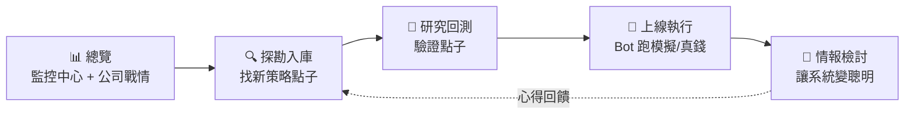
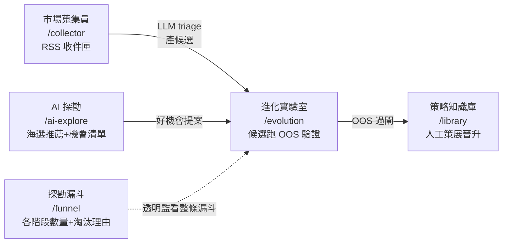
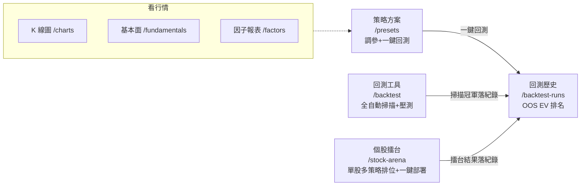
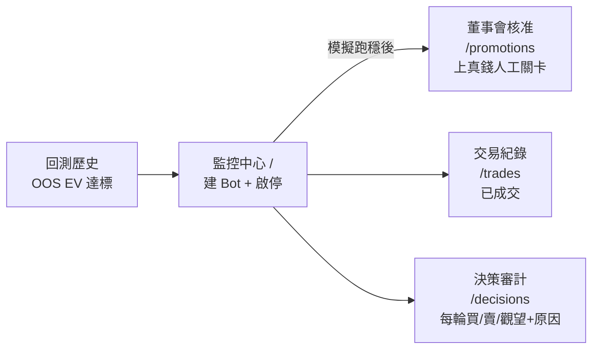
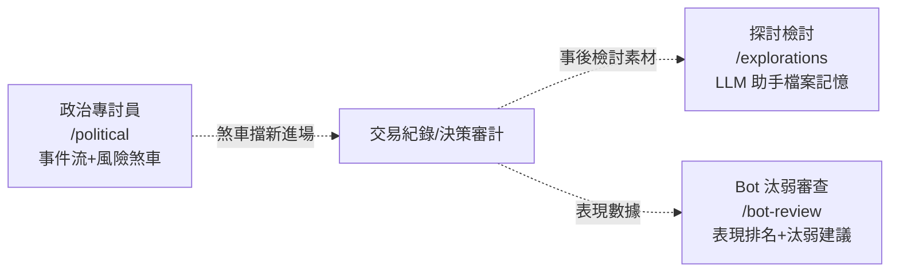
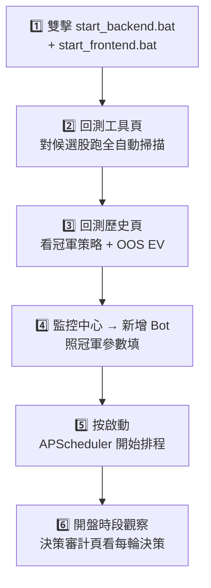

# 前端頁面地圖與操作順序

> 左側 sidebar 共 20 頁，乍看很多，其實分四條「工作流」+ 兩個總覽頁。
> 本文：① 鳥瞰圖 ② 四條工作流各一張小圖 ③ 開第一隻 Bot 的步驟 ④ When/What/Why 對照
> ⑤ 進階管線通電（Ollama／蒐集員／探勘橋／政治員） ⑥ 各頁資料來源。
>
> 圖刻意拆小張、用橫向排版——一張塞 20 個節點瀏覽器會縮到看不清。

## ① 鳥瞰：四條工作流怎麼接



每天操作順序：**總覽看狀態 → 找點子 → 回測驗證 → 上線追蹤 → 檢討回饋**。

## ② 四條工作流（各頁面在哪一條）

### 工作流 1：探勘入庫（找新策略點子）



### 工作流 2：研究回測（驗證點子值不值得）



### 工作流 3：上線執行（讓 Bot 跑起來）



### 工作流 4：情報與檢討



## ③ 開第一隻 Bot（模擬交易，step by step）



建 Bot 表單建議值（第一隻）：

| 欄位 | 建議 | 為什麼 |
|------|------|--------|
| 股票 symbol | 回測歷史裡 OOS EV 高的 | 有樣本外依據，不是亂猜 |
| 策略 + 參數 | 照掃描冠軍填 | 同上 |
| trade_amount | 小額（$1000） | 模擬也養好習慣 |
| 檢查間隔 | 5~15 分鐘 | 太密浪費 API 額度 |

注意：

- 美股盤時（台灣夏令約 21:30–04:00）Bot 才動作；休市時決策審計記 `skipped_market_closed`。
- `.env` 已設 paper URL + `ALLOW_LIVE_TRADING=false`，雙閘擋真錢，模擬絕對安全。
- 上真錢另走董事會核准頁，模擬跑穩前別碰。

## ④ 模擬交易的 When / What / Why 都記在哪

| 問題 | 有沒有 | 記在哪 |
|------|--------|--------|
| When 什麼時間決策 | ✅ | `decision_logs.created_at`（每輪檢查都記，含沒動作的） |
| What 做了什麼 | ✅ | `decision_logs.action`：買/賣/續抱觀望/休市跳過/熔斷跳過/購買力不足 |
| Why 為什麼買賣 | ✅ | `decision_logs.reason`：策略訊號原因（黃金交叉、RSI 超賣、觸發止損…） |
| 買多少 | ✅ | `trade_logs`（股數+價格）；金額來自建 Bot 時設的 `trade_amount` |
| 為什麼選這支股票 | ❌ 缺 | symbol 是建 Bot 時手動填的，系統不記動機（待補：Bot `note` 欄位） |

決策審計頁 = 這張表的前端窗口。**沒有 Bot 在跑就永遠 0 筆**——先開 Bot 才有料。

## ⑤ 進階管線通電（蒐集員 / 探勘橋 / 政治員）

> 這三個都是選用功能，預設關。開了之後「探勘入庫」工作流才會自己長資料。

### 前置：Ollama（本機 LLM，探勘橋與政治員都靠它）

```powershell
# 1. 檢查有沒有裝（沒裝去 https://ollama.com 下載）
ollama --version

# 2. 檢查服務有沒有在跑（Windows 版裝完通常開機自動跑）
#    瀏覽器開 http://localhost:11434 看到 "Ollama is running" 即可
# 3. 確認模型已下載（.env 的 LLM_MODEL 預設 llama3.1）
ollama list
# 沒有的話：
ollama pull llama3.1
```

服務沒跑時手動啟動：`ollama serve`（或重開 Ollama 桌面程式）。
沒裝 Ollama 不會壞——相關 API 優雅回 400，其他功能照常。

### 市場蒐集員（RSS 收料 → 收件匣）

`.env` 填三行，重啟後端生效：

```bash
COLLECTOR_RSS_FEEDS=https://www.reddit.com/r/algotrading/.rss,https://www.reddit.com/r/quant/.rss,https://www.quantstart.com/feed/
COLLECTOR_INTERVAL_MIN=60          # 每小時收一次；0 = 關
COLLECTOR_USER_AGENT=AlbeeStock-Collector/1.0 (personal research)
```

素材進「市場蒐集員」頁收件匣。只收料、不驗證、不部署。

### 探勘橋 + 自動驗證（收件匣 → 候選 → OOS 驗證）

```bash
DISCOVERY_ENABLED=true       # 每日 7 點：Ollama 讀素材 → 產 candidate
AUTO_VALIDATE_ENABLED=true   # 每日 8 點：candidate 批次過 OOS 閘 → validated/rejected
```

晉升 curated 仍須人工（知識庫頁按鈕）——人在迴路鐵則。
電腦沒 24 小時開也沒關係：`CATCHUP_ON_BOOT=true` 開機自動補跑當天漏掉的。

### 政治專討員（Discord 鏡像頻道 → 風險煞車）

前提：有一個「同步川普貼文進來的 Discord 鏡像頻道」。步驟：

1. https://discord.com/developers/applications → New Application → Bot →
   Reset Token 複製 → 填 `POLITICAL_DISCORD_TOKEN`
   （同頁務必打開 **Message Content Intent**，否則讀不到貼文內容）
2. OAuth2 → URL Generator → 勾 `bot` + `View Channels` → 用產生的連結把 bot 拉進伺服器
3. Discord 開發者模式 → 右鍵頻道 → 複製頻道 ID → 填 `POLITICAL_CHANNEL_ID`
4. `POLITICAL_AUTHOR_FILTER=` 填鏡像 bot 顯示名稱（留空 = 收整個頻道）
5. `POLITICAL_ENABLED=true`（總開關，沒開 = size_factor 一律 1.0 不煞車）
6. runner 獨立跑（另開視窗，不在 FastAPI 裡）：

```powershell
venv\Scripts\python.exe -m backend.bots.political_watcher
```

定位是**煞車不是油門**：偵測高風險政治事件 → 新倉 size 打折，不開新倉、不擋出場。
事件超過 `POLITICAL_EVENT_MAX_AGE_HOURS`（預設 24h）自動退場。

啟動回補：runner 一開就抓頻道最近 `POLITICAL_BACKFILL_LIMIT`（預設 5）筆**有文字**的
歷史貼文判讀落表——電腦沒 24h 開機也不漏最新政治情緒；重啟不重複寫（同作者同時間防重）。

## ⑥ 各頁面資料來源（誰寫進去的）

| 頁面 | 讀的資料 | 資料由誰產生 |
|------|----------|--------------|
| 回測歷史 | `backtest_runs` 表 | ①策略方案頁「一鍵回測」 ②回測工具「全自動掃描」 ③每日領導股排程（`daily_watch.py`，預設開、每天 10 點自動跑） |
| 決策審計 | `decision_logs` 表 | Bot 每輪檢查（`bot_manager._record_decision`） |
| 進化實驗室 | `strategy_knowledge` 表 | LLM 提案（Phase 8）+ 探勘橋 triage（Phase 12，預設關） |
| 探討檢討 | `explorations/` 檔案 | 思考助手對話中手動存的探討/檢討 |
| 交易紀錄 | `trade_logs` 表 | Bot 真的成交才寫 |
| 市場蒐集員 | `raw_strategy_finds` 表 | RSS 爬蟲（`COLLECTOR_RSS_FEEDS` 填了才動） |
| 政治專討員 | `political_events` 表 | Discord bridge（`POLITICAL_*` 填了才動） |
| 探勘漏斗 | `/company/overview` 的 `discovery_funnel` | collector/discovery/auto_validate 各段計數（Phase 12/14） |
| 個股擂台 | `backtest_runs` 表（依 symbol 聚合） | 擂台頁「跑一輪」對單股掃全策略（Phase 14） |
| Bot 汰弱審查 | `bots` + `trade_logs` 彙整（`bot_review.py`） | 每日排程/手動跑一次產審查建議（Phase 15） |
