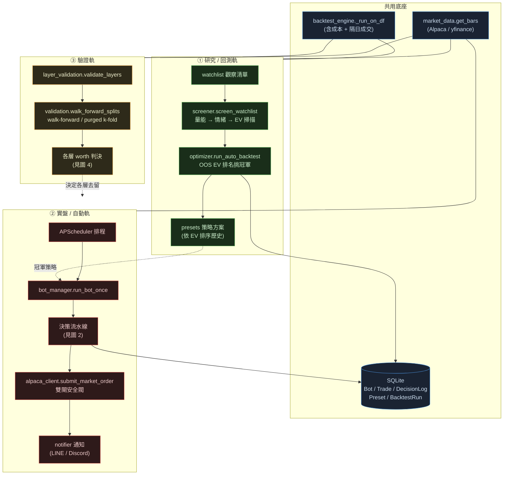
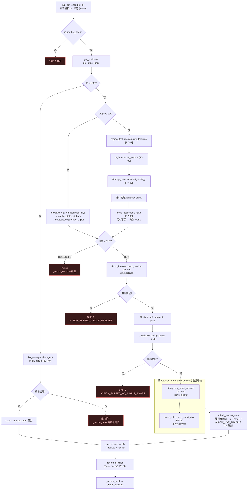
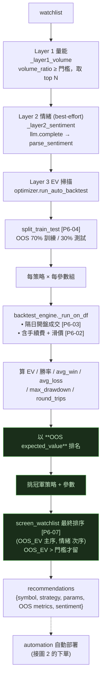
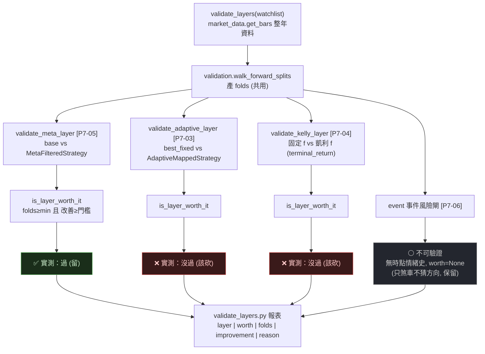
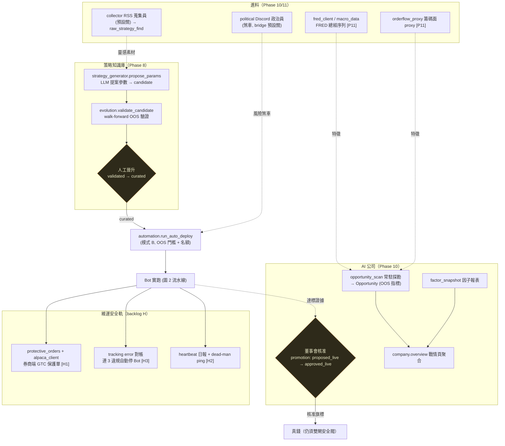

# Albee_Stock 交易系統工作流圖

> 用 [Mermaid](https://mermaid.js.org/) 畫（圖即程式碼，進 git）。
> **看圖方式**：推上 GitHub 自動渲染，或 VSCode 裝「Markdown Preview Mermaid Support」擴充後預覽。
>
> 共 5 張圖：
> 1. [高層全景](#圖-1高層全景) — 三大子系統一張看懂
> 2. [即時/自動交易決策流水線](#圖-2即時自動交易決策流水線flow-a) — Bot 每輪怎麼決策下單
> 3. [回測 / EV 流水線](#圖-3回測--ev-流水線flow-b) — 怎麼挑出冠軍策略
> 4. [Phase 7 層驗證流](#圖-4phase-7-層驗證流flow-c) — 每層加分到底值不值得留
> 5. [Phase 8–11 知識庫 → AI 公司軌](#圖-5phase-811-知識庫--ai-公司軌flow-d) — 素材進料、知識庫晉升、戰情監控、維運安全
>
> 圖內容已對照 `backend/` 實際程式碼流程，非憑記憶。

---

## 圖 1：高層全景

整個系統三條軌 + 共用底座。研究軌挑策略 → 實盤軌執行 → 驗證軌檢查各層是否真的加分。

---

## 圖 2：即時/自動交易決策流水線（Flow A）

`bot_manager.run_bot_once(bot_id)` 每輪實際順序。紅色 = SKIP 出口（不下單）。
標籤 `[P6-xx]` / `[P7-xx]` = Phase 6 / Phase 7 第幾步。

> ⚠️ **Kelly 部位（P7-04）與事件風險閘（P7-06）只在 `automation.run_auto_deploy` 自動部署流**，
> **不在**手動 Bot 流。圖中以虛線框標出。

---

## 圖 3：回測 / EV 流水線（Flow B）

`screener.screen_watchlist` → `optimizer.run_auto_backtest`：三層篩出冠軍策略，
**一律看樣本外（OOS）EV** 排名，不在整段歷史挑樣本內最佳（防過擬合）。

---

## 圖 4：Phase 7 層驗證流（Flow C）

`layer_validation.validate_layers`：用 walk-forward 切 folds，每層拿 **baseline vs candidate**
都跑 `_run_on_df`，比 OOS 改善是否過門檻。誠實判決「這層加分到底值不值得留」。

---

## 圖 5：Phase 8–11 知識庫 → AI 公司軌（Flow D）

Phase 8（策略知識庫 + 人在迴路晉升）、Phase 10（AI 公司編排）、Phase 11（總經資料地基）
與 backlog H（維運安全軌）怎麼接在一起。**人工關卡只有兩個**：知識庫晉升、董事會核准。

---

## 對照表：圖 ↔ 程式碼

| 圖 | 入口函式 | 關鍵模組 |
|----|----------|----------|
| 圖 2 實盤 | `bot_manager.run_bot_once` | `regime_features` / `regime` / `strategy_selector` / `meta_label` / `circuit_breaker` / `capital` / `risk_manager` / `alpaca_client` |
| 圖 3 回測 | `screener.screen_watchlist` → `optimizer.run_auto_backtest` | `backtest_engine._run_on_df` / `optimizer.split_train_test` |
| 圖 4 驗證 | `scripts/validate_layers.py` → `layer_validation.validate_layers` | `validation.walk_forward_splits` / `validation.is_layer_worth_it` |
| 圖 5 知識庫/公司 | `routers/knowledge.py` / `routers/company.py` | `strategy_generator` / `evolution` / `opportunity_scan` / `collector` / `political` / `heartbeat` / `tracking` / `protective_orders` |

> 圖會跟程式碼演進而過期。改動 `backend/` 流程順序時，記得同步本檔。
